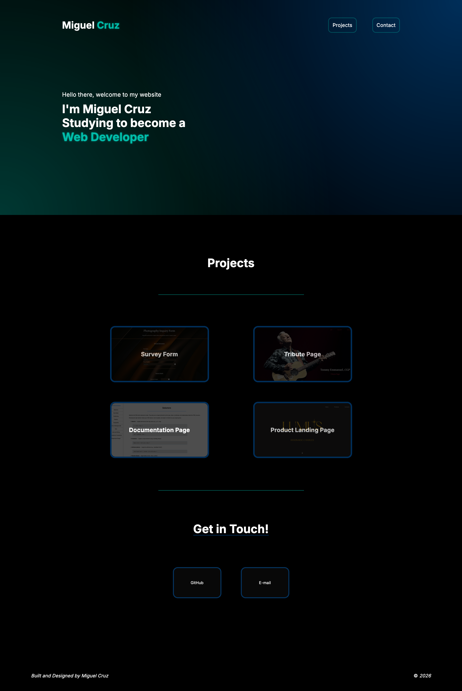
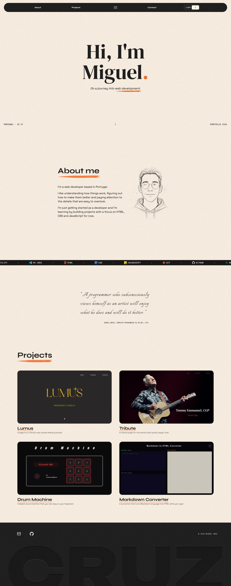
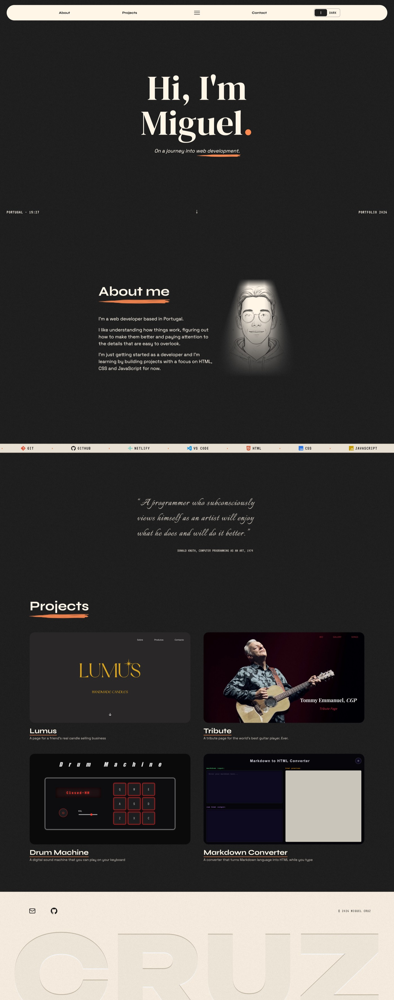
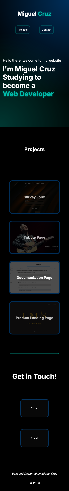
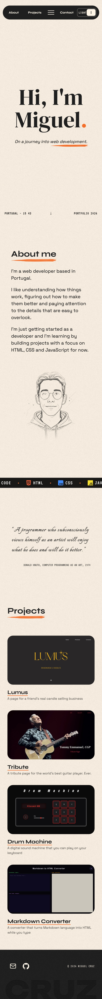
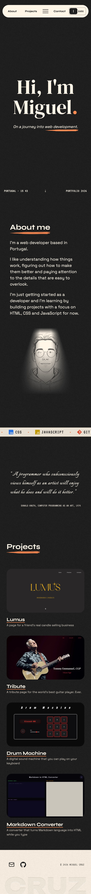

# Personal Portfolio

This is my web developer portfolio. It started as a project for the Responsive Web Design course on freeCodeCamp.

I decided to rebuild my portfolio because the first version, which you can see in the screenshots below, didn't match my idea of what good design looks like. I liked the result back then, but once I'd learned the basics of JavaScript and looked at the old design again, I realised I'd have to redo almost everything: the colours, the features, the content. I started again with the eye of someone who has since seen a lot of websites and has a more modern, more polished idea of what my portfolio should look like.

Once I had a few ideas, the project grew far beyond what I first planned, and I went past what I knew at the time to build some of the animations on the site. What was meant to be a quick redesign became a portfolio I'm very proud to show, and it taught me a lot as a front end developer.

Portfolio: [Live demo](https://miguel-cruz-dev.netlify.app)

## Before and after

 

### <ins>Desktop Version</ins>

 

<table>
  <tr>
    <td align="center"><b>Old design</b></td>
    <td align="center"><b>New design - light</b></td>
    <td align="center"><b>New design - dark</b></td>
  </tr>
  <tr>
    <td align="center" valign="top"></td>
    <td align="center" valign="top"></td>
    <td align="center" valign="top"></td>
  </tr>
</table>

 

### <ins>Mobile Version</ins>

 

<table>
  <tr>
    <td align="center"><b>Old design</b></td>
    <td align="center"><b>New design - light</b></td>
    <td align="center"><b>New design - dark</b></td>
  </tr>
  <tr>
    <td align="center" valign="top"></td>
    <td align="center" valign="top"></td>
    <td align="center" valign="top"></td>
  </tr>
</table>

## What I built

### Interface (HTML and CSS)

- **The page itself.** A hero, an About section with a short text and my portrait, a strip with my tool stack, a quote from Donald Knuth, a grid with four projects and a footer with my email and GitHub.
- **A new look.** Warm paper colours with a grain texture and an orange accent, in a light and a dark theme. In the dark theme the portrait lights up like a bulb.
- **New typography.** DM Serif Display for the big title, Syne for headings and navigation, Space Grotesk for text, VT323 for the small "screen" details, Italianno for the handwritten statement and Unbounded for the big name in the footer.
- **Fully responsive.** Text sizes scale smoothly with the screen width, and I tested it on a real phone.
- **Brush-stroke underlines** under the section titles, and in the hero phrase.
- **SVGs, for the first time.** The brush strokes and the tool icons are SVG files used as masks, so one shape can be recoloured with CSS, and the email icon is an inline SVG.
- **A sketch effect on my portrait.** Layers of masks and blend modes, plus a blur that sharpens on scroll, make the drawing look like it was sketched straight onto the page.

### Functionality (JavaScript)

- **A floating navigation island** that opens from one button and hides when you scroll down.
- **Scroll animations** with `IntersectionObserver`: the brush strokes, the portrait and the hero arrow.
- **A live clock** showing the time in Portugal, even if the visitor is in a different timezone.
- **A theme toggle** that switches the whole page from light to dark theme and replays the portrait effect in the dark theme.

## Notable decisions

- **One fluid formula instead of a size per breakpoint.** With `clamp()` and `vw`, the big title keeps the same proportions on every screen.
- **Project title underline always on for touch screens.** There's no hover on a phone, so `(hover: none)` keeps the line visible.
- **A single button instead of a navigation bar.** The links stay hidden until you open it, so the page stays clean.
- **Colour on hover only for devices with a mouse.** The project images are grey until you hover over them, but only on devices with a mouse. On touch screens they just stay in colour.
- **The dark theme needed its own effect.** The sketch effect on my portrait disappeared on a black background, so I had to figure out a way to light it up. That's where the bulb effect idea came from.
- **Contact in the footer, no form.** Two icons, email and GitHub. Decided to keep it simple.
- **Animations respect the visitor's settings.** If the system asks for less motion, the animations are turned off.
- **The big name in the footer moves up on phones**, so the browser's bottom bar doesn't hide it.

## What I learned

- Media queries cascade: a smaller block only has to repeat what changes.
- Hover doesn't exist on touch screens, and `(hover: none)` asks the device which kind it is.
- A real phone shows things the browser's responsive mode doesn't.
- How to use `clamp()` to make sizes that follow the screen width. The size grows as the screen gets wider until it reaches the min or max limit.
- How to use SVGs, both as masks, so one file can be recoloured with CSS, and inline, so they follow the text colour.
- How to layer masks, gradients and blend modes to make an image look sketched onto the page, and to make it light up in the dark theme.
- How to build animations with CSS transitions and keyframes (fades on load, a blinking clock colon, an endless scrolling strip, a brush that draws itself), and how to start them on scroll with `IntersectionObserver`.
- How to build the navigation island: one box that changes width, a circle that grows to fill it, and JavaScript adding and removing classes.
- How to make a dark theme by redefining CSS custom properties from a single attribute on `<html>`.
- How to react to scrolling, clicks and a timer in JavaScript, for the hide-on-scroll navigation, the buttons and the live clock.
- How to test on more than one browser. Things that looked perfect in Brave and Firefox broke in Safari, so I had to make it work the same everywhere, and I learned to use each browser's inspector tools to debug.

## Known limitations

- The theme isn't remembered when the page reloads, and it doesn't follow the visitor's system theme.
- The projects are written directly in the HTML, so adding one means copying a card by hand instead of the page building them from a list. (coming soon...)
- I tested it on Firefox, Brave, Safari on a Mac and one Android phone, but not on an iPhone.

## Built with

HTML, CSS and vanilla JavaScript. No frameworks or libraries. Hosted on Netlify.