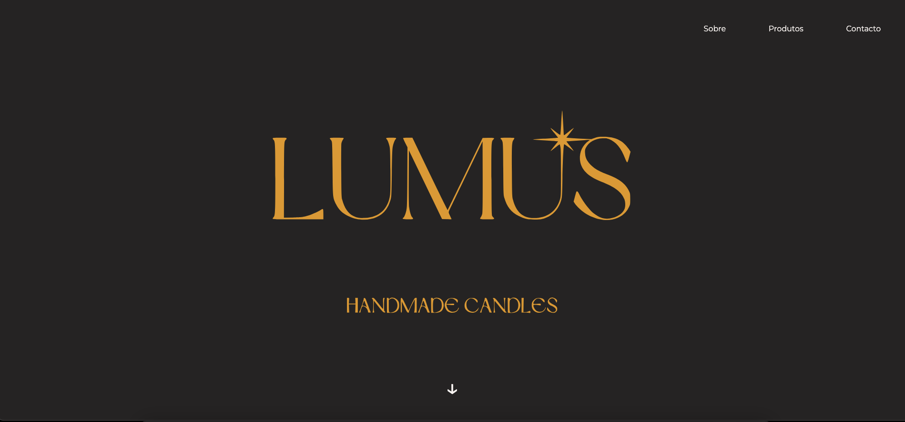
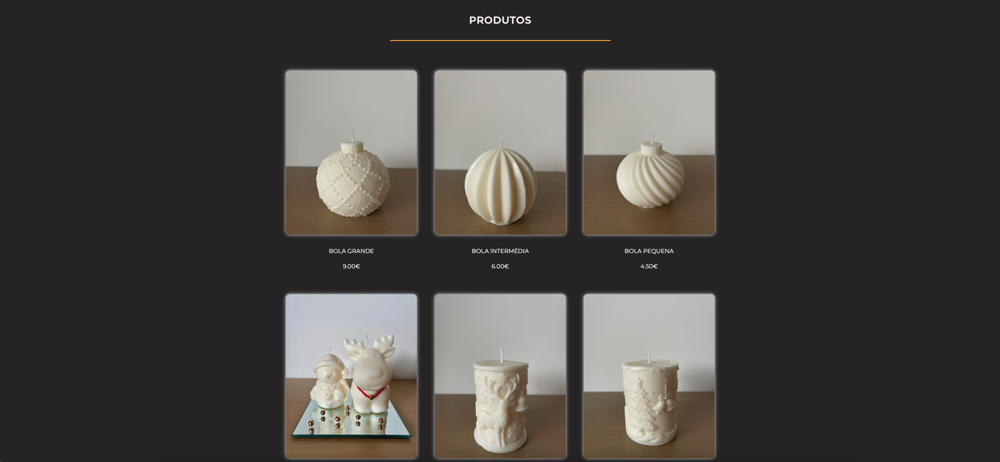
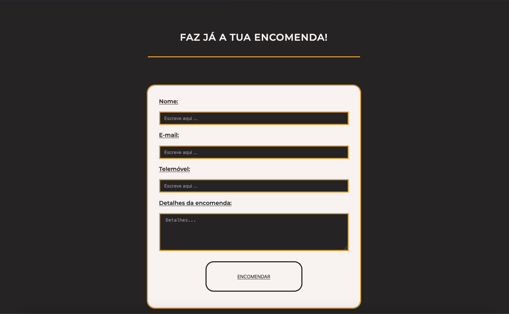
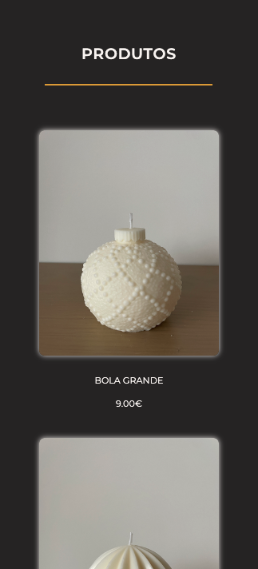

# Lumus: Product Landing Page

I wanted to build something real for this certification project, so instead of an invented business I built it for a friend who was selling candles and struggling to show her products with their prices. I went well past what the course asked for, because I wanted a page professional enough to put online. That meant figuring out things the course didn't cover: chaining the animations across the page, deploying on Netlify, sending the form to a real email, and a thank-you page that opens after submitting. I designed it to feel like candlelight, and it was by far the most complex CSS I'd written up to that point.

[Live demo](https://lumuscandles.netlify.app)

 

 

## The need

This is one of the five Responsive Web Design certification projects. A friend was making handmade candles and was selling Christmas-themed ones through Instagram.

Every candle had its own photo, so people had to message her to ask the price of each one, and she kept answering the same questions. She had printed a price list for local shops, but that only reached people nearby. I made a page where anyone can browse the products with their prices and send an order request without needing a chat.

## What I built

- **A hero section** where the logo, the navigation and the scroll arrow fade in one after another.
- **A navigation bar** with smooth-scrolling links and an animated underline on hover.
- **An about section** and a **product grid** with eight products, photos and prices. It's three columns on desktop, two on tablets and one on phones.
- **An order form** (name, email, phone, order details) that sends the order to her email, then takes the customer to a thank-you page.
- **An Instagram link** in the footer for ordering through direct messages.
- **A dark, cream and gold look** with Montserrat, written in Portuguese.

## Notable decisions

- **An order form instead of a shop.** She needed a way to show prices and receive requests, not payments, so she confirms each order with the customer herself. I also didn't know how to build checkout and payments yet.
- **A second page for the thank-you message.** Without JavaScript, I couldn't show a message in place after submitting, so the form sends people to `thank-you.html`.
- **Netlify Forms for the orders.** The form has a hidden `form-name` input so Netlify recognises it, and submissions arrive in her email.

## What I learned

- This was my first Netlify deploy, and the first time I connected a form to a real email. I've used Netlify for every project since.
- Building the product layout with CSS grid and changing the number of columns by screen size.
- Chaining fade-in animations: elements start at `opacity: 0` and fade in one after another with `animation-delay` and `forwards`.
- Making something good enough to put online for a real person is much harder than finishing an exercise.

## Known limitations

- No cart, login or payments. Orders go through the form or Instagram and are confirmed by hand.
- Products and prices are written directly in the HTML, so every change means editing code.

## Built with

HTML and CSS (grid, animations). No frameworks and no JavaScript. Hosted on Netlify, using Netlify Forms.